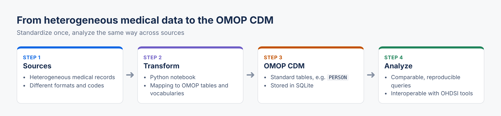

# Standardisation des données médicales au format OMOP

> 🇬🇧 **English summary:** Transforms heterogeneous medical data into the OMOP Common Data Model (OHDSI standard) so it can be queried and analyzed consistently. Built with Python and SQLite in a Jupyter notebook.

## Objectif:

Transformer des données médicales hétérogènes en un format standardisé (OMOP).

## Format standardisé OMOP:

Le format standardisé OMOP (Observational Medical Outcomes Partnership) est un modèle de données développé pour faciliter la standardisation et l'intégration des données médicales de diverses sources afin de permettre une analyse comparative efficace et reproductible.

#### Définition de l'OMOP Common Data Model (CDM)

Le OMOP Common Data Model (CDM) est un modèle de données relationnelles conçu pour structurer les données de santé provenant de différentes sources, telles que les dossiers médicaux électroniques, les registres de patients, les données de réclamations d'assurance, et autres. Le CDM permet de :

1. **Standardiser les Formats** : Convertir les données de santé hétérogènes en un format commun et cohérent.
2. **Faciliter l'Analyse** : Permettre des analyses comparatives et reproductibles à grande échelle.
3. **Promouvoir l'Interopérabilité** : Faciliter l'échange et la comparaison de données entre différentes institutions et systèmes.

## 📜 Licence

Ce projet est sous la [Licence MIT](https://github.com/GhntSergio/OMOP-model/blob/main/LICENSE). Voir le fichier [LICENSE](https://github.com/GhntSergio/OMOP-model/blob/main/LICENSE) pour plus de détails.
